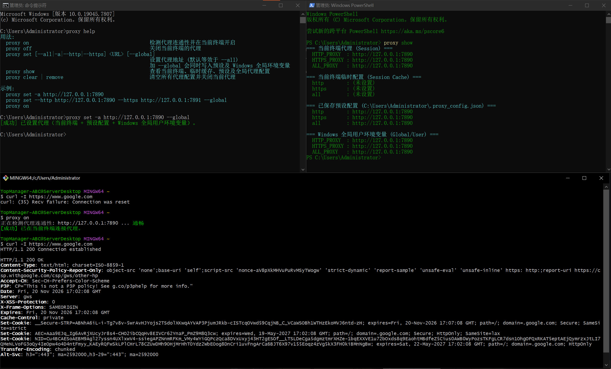

<div align="center">

#  win-proxy-cli

  
  
  
  
  

  一个轻量级、原生免依赖的 Windows 终端代理管理工具，使得 **PowerShell**、**CMD** 与 **Git Bash** 拥有一致、可控的代理开关体验。

</div>




---

## 要我做什么？

本项目只为解决一个痛点：**新创建的终端窗口通常不会自动连接本地代理**，即使你已经在 Windows 上开启了代理软件。

啊你可能会问，直接把代理地址写死在系统环境变量里不就行了吗？那你关闭代理软件，终端里的 `git`、`curl`、`pip`、`npm` 等工具就立马报错了。

`win-proxy-cli` 通过**单一共用核心脚本 + 按需检测开启 + 临时与全局隔离**解决了这个痛点：

* **连通性预检**：执行 `proxy on` 时自动对代理端口做 TCP 握手检测；
* **三端一致体验**：PowerShell、CMD、Git Bash 拥有完全相同的操作体验与全局配置 `~/.proxy_config.json`；
* **临时会话与全局配置分离**：不加 `--global` 时仅在当前终端窗口生效（支持窗口内 `off` / `on` 切换，关闭窗口自动失效）；加 `--global` 会写入全局预设与 Windows 用户级环境变量；
* **Git Bash 大小写自动兼容**：在 Git Bash 中自动同步设置/清理小写变量（`http_proxy` / `https_proxy` / `all_proxy`），并且适配 `curl` 等区分大小写的 Unix 工具。

---

## 仓库结构

```text
win-proxy-cli/
├── proxy_core.ps1          # 核心共用后端（连通性检测、JSON 配置读写、环境变量管理）
├── proxy.ps1               # PowerShell 入口（进程内调用）
├── proxy.bat               # CMD 入口
├── proxy.sh                # Git Bash 入口
├── assets/
│   └── all_terminals.png   # 演示截图
├── .gitattributes          # 锁定各端脚本的换行符规范
├── .gitignore
└── LICENSE
```

---

## 装进你的电脑

首先将仓库克隆到本地固定目录（eg. `C:\Users\<你的用户名>\Documents\win-proxy-cli`，以下示例都以此路径演示）：

```bash
git clone https://github.com/SRInternet/win-proxy-cli.git
```

> [!TIP]
> **请把 <你的用户名> 替换为你自己的 Windows 用户名**
> 
> 如果你不知道自己的用户名，可以在 Windows 运行 `net user` 查看所有用户。

按你平时使用的终端类型配置对应入口即可（三者配置独立，可全部配置也可只配常用的）：

### 1. PowerShell（Windows PowerShell 5.1 / PowerShell 7+）

1. 如之前**未启用过本地脚本加载**，必须先允许当前用户加载配置文件：
   ```powershell
   Set-ExecutionPolicy RemoteSigned -Scope CurrentUser
   ```
2. 打开（或创建）PowerShell 配置文件 `$PROFILE`：
   ```powershell
   if (!(Test-Path -Path $PROFILE)) { New-Item -ItemType File -Path $PROFILE -Force }
   notepad $PROFILE
   ```
3. 在 `$PROFILE` 中添加一行（将路径替换为你的实际仓库路径）：
   ```powershell
   . "C:\Users\<你的用户名>\Documents\win-proxy-cli\proxy.ps1"
   ```
4. 保存后重启终端或运行 `. $PROFILE` 生效。

> [!NOTE]
> 如果你同时安装了系统自带的 Windows PowerShell 5.1 和新版的 PowerShell 7+，两者的 `$PROFILE` 路径不同，分别在两个终端执行一次上述步骤即可。

### 2. CMD（命令提示符）

将仓库目录（eg. `C:\Users\<你的用户名>\Documents\win-proxy-cli`）添加到 **Windows 用户环境变量 `Path`** 中，重新打开 CMD 即可直接使用 `proxy` 命令。

### 3. Git Bash

1. 编辑 `~/.bashrc`（文件不存在会自动创建），添加一行引用（注意路径使用 Unix 风格斜杠，例如 `C:` 写为 `/c`）：
   ```bash
   source "/c/Users/<你的用户名>/Documents/win-proxy-cli/proxy.sh"
   ```
2. 在 Git Bash 中执行 `source ~/.bashrc` 或重启终端即可生效。

---

## 命令用法

| 命令 | 说明 |
| :--- | :--- |
| `proxy on` | 检测已配置代理的端口连通性，通畅后在当前终端启用代理 |
| `proxy off` | 断开当前终端的代理（保留当前终端的临时缓存与全局预设） |
| `proxy set [协议参数] <URL> [--global]` | 设置代理地址。协议参数支持 `--all` / `-a`、`--http`、`--https`（省略时默认等效于 `--all`） |
| `proxy show` | 查看当前终端代理、临时缓存、预设配置文件及 Windows 全局环境变量 |
| `proxy clear` / `proxy remove` | 清空当前终端代理、临时缓存、预设配置文件以及 Windows 全局环境变量 |
| `proxy [其他任意参数]` | 显示帮助信息 |

### 常见使用示例

```bash
# 1. 仅在当前终端临时测试代理（不影响其他窗口，不写入全局配置）
proxy set -a http://127.0.0.1:7890

# 2. 分别指定 HTTP 与 HTTPS 代理，并保存为全局配置
proxy set --http http://127.0.0.1:7890 --https http://127.0.0.1:7891 --global

# 3. 支持 SOCKS5 协议（也可省略协议头，默认补全 http://）
proxy set -a socks5://127.0.0.1:7891
proxy set 127.0.0.1:7890

# 4. 临时关闭与重新检测开启
proxy off
proxy on

# 5. 查看所有层级状态 / 彻底清空配置
proxy show
proxy clear
```

---

## 注意事项

> [!IMPORTANT]
> **你的 HTTPS 代理就是 `https://` 开头的吗？（必看）**
>
> `--https` 设置的是环境变量 `HTTPS_PROXY`，表示“访问 HTTPS 网站时经由哪个代理服务器”，**而不是指代理服务器本身使用了 HTTPS 协议**。
> 大多数本地代理客户端（Clash、FlClash、Mihomo、v2rayN 等）在本地端口（如 `127.0.0.1:7890`）上运行的是**明文 HTTP / SOCKS5 服务**，并没有 TLS 证书。因此对于大多数情况而言：
>
> * ✅ 正确写法：`proxy set --https http://127.0.0.1:7890`
> * ❌ 错误写法：`proxy set --https https://127.0.0.1:7890`（会导致 `curl` 等工具尝试与本地端口进行 TLS 握手，报 `SSL/TLS connection failed`）

> [!TIP]
> **关于作用域与生效范围**
> * **临时模式（不加 `--global`）**：配置保存在当前终端的会话缓存中，窗口内可随时用 `proxy off` / `proxy on` 开关，关闭窗口即销毁。
> * **全局模式（加 `--global`）**：配置同时写入 `%USERPROFILE%\.proxy_config.json` 与 Windows 用户级环境变量。新打开的终端会自动继承全局环境变量；已经提前打开的旧终端窗口如需同步，只需在旧窗口中执行一次 `proxy on` 即可。

---

## License

[MIT](LICENSE)
